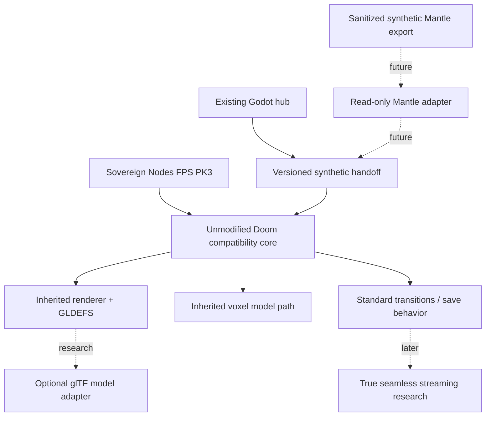

# Architecture seam reconnaissance — draft 000A

## Non-negotiable contract boundary

Godot and Doom currently run as **separate processes**. Do not turn the Doom FPS into a Godot scene or couple its game runtime directly to a genealogy backend. All bridge payloads are local, versioned, sanitized and strictly validated before gameplay consumption; version 1 legacy behavior is source-observed, but security hardening is future work.

## First code seam rule

The first authorized fork phase should compile the chosen upstream **unchanged**, record the current-game baseline, then introduce one bounded extension. No source fork or copy is authorized by this document.
