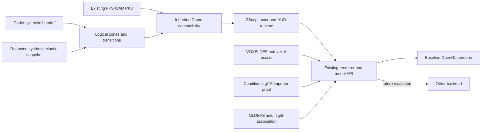

# SNE-WO-000B — Engine boundaries, not yet implementations

## Diagram limitations

Logical interfaces are planning boundaries. Nothing in this diagram proves an engine can load physically adjacent WAD maps without a transition, that rendering backends are interchangeable, or that a Mantle bridge currently exists.
