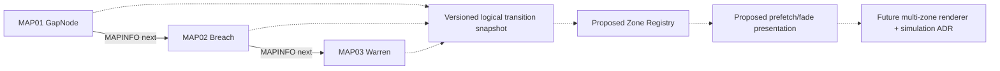

# SNE-WO-000C — World continuum stages

Solid arrows are **source-declared map links**, not tested progress. Dotted arrows are **design proposals**. Continuous physics/render state between maps is not an inherited guarantee.
