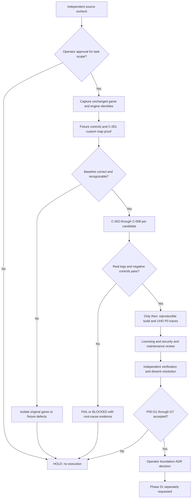

# WO-F — Evidence closure and gate promotion flow

The diagram describes conditional future work; it neither launches tests nor marks any G1–G8 as satisfied. `G8` remains HOLD until operator signoff.
