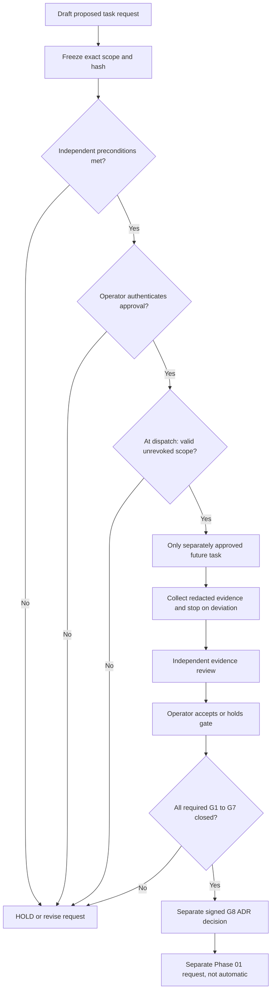

# F-01 — Proposal, approval and execution gate graph

No state is transitioned by reading/extracting this package. In particular, the existence of a `templates/*AUTHORIZATION.json` object is not proof of a signed approval or independent review.
