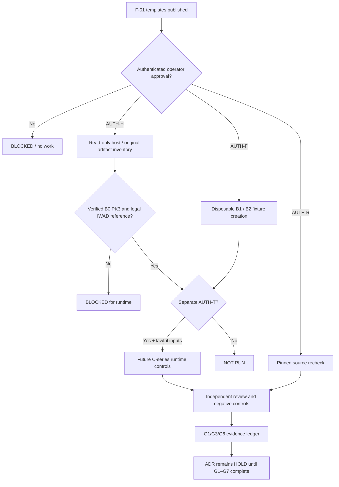

# F-02 — Evidence and authorization dependency graph

A source claim, a static package layout, an independently signed review and a gameplay result are distinct types of evidence. This diagram is a proposed process, not an executed graph.
