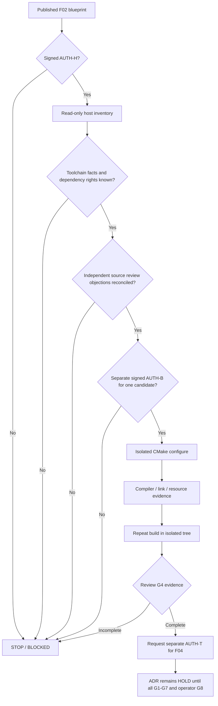

# F-03 — Conditional build-gate dependency graph

Arrows represent **conditional prerequisites**, not permission or commands for an agent. Independent reviewer must be distinct from author; a source-claim review does not replace a measured G4 review.
