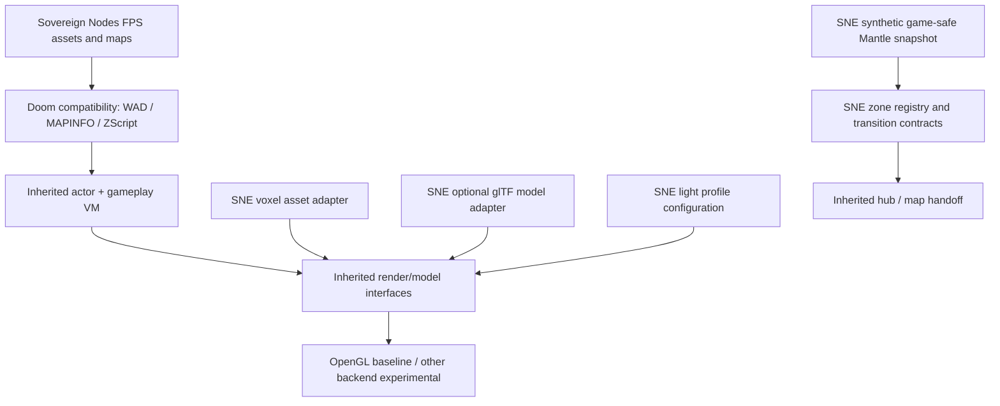

# SNE-WO-000B — Hybrid engine extension boundary proposal

**Design status:** PROPOSED ONLY. Logical layers are not mandatory new static libraries or source-tree rewrites.

## Mapping

## API seam ownership contracts

| Boundary | Inputs | Outputs | Required invariants |
|---|---|---|---|
| VoxelModelAdapter | vetted voxel resource + actor/frame descriptor | imported model handle | gameplay hitboxes and ZScript do not change; load rejection safe |
| ModelAssetAdapter | optional glTF/GLB + textures + declared materials | engine model handle | no arbitrary code, bounded memory, deterministic errors, renderer fallback |
| LightingProfile | scene light definitions + profile L/H/X | CVAR/render options | fallback has no expensive shadows; GLDEFS actor binding unchanged |
| ZoneTransitionAdapter | zone IDs + portal/exit + state metadata | current/next map identity | no invented persistence; original three maps remain reachable |
| MantleSnapshotReader | signed synthetic allowlisted JSON snapshot | sanitized game-safe data | offline, read-only, version checked, size bounded; never directly access Mantle ledger |
| GameCompatibilityProbe | test PK3 + synthetic handoff | logs / observable map identity | missing custom map/actor is FAIL; no false PASS from IWAD startup |

## Incremental enforcement

- **First:** prove inherited behavior in original game, then on selected upstream binary, *without changing engine sources*.
- **Second:** add an isolated voxel actor/prop model replacement through supported asset definitions. Measure visual and gameplay parity.
- **Third:** tune lighting profile with existing GLDEFS/CVAR surfaces and collect frame times.
- **Fourth:** only if native glTF is a hard requirement, evaluate BiasedDoom experiment and sustainable import path; code-porting requires separate copyright/merging review.
- **Fifth:** use current map handoffs before proposing simultaneous loaded zones.

## Explicitly deferred

Replacing Doom's simulation, new ZScript dialect, GPU renderer rewrite, chunk voxel terrain, real-person genealogy exports, native Python mod execution, network multiplayer compatibility promises, physical seamless portals.
